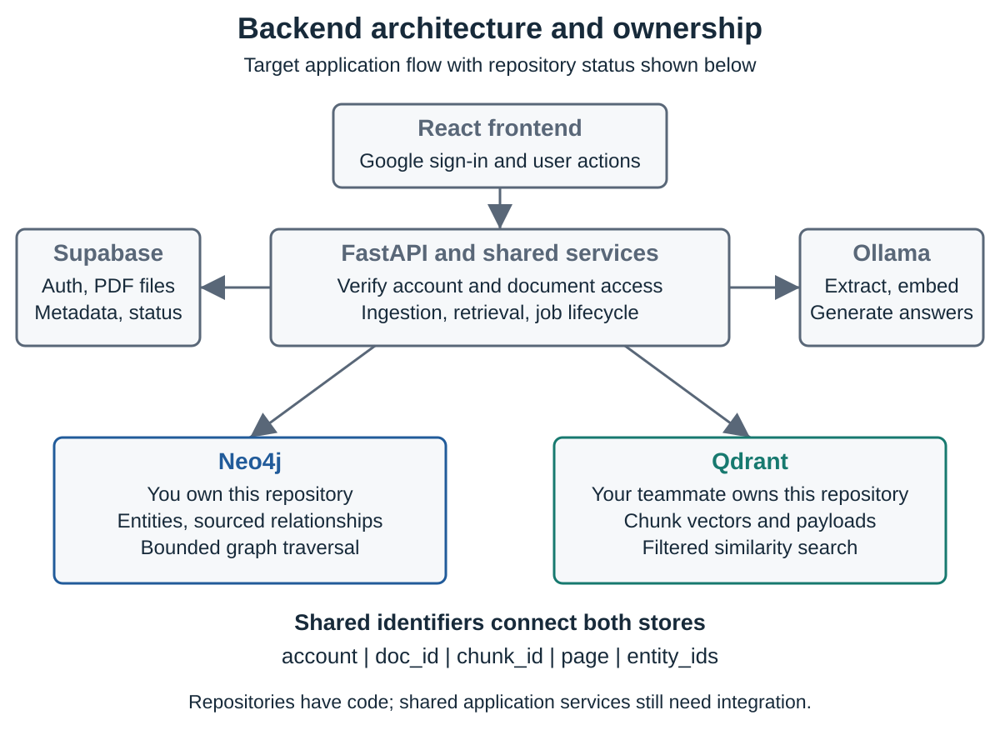
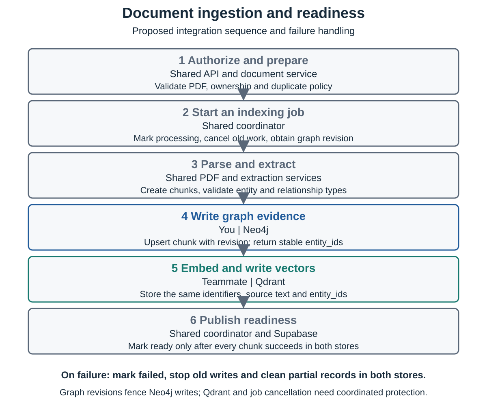
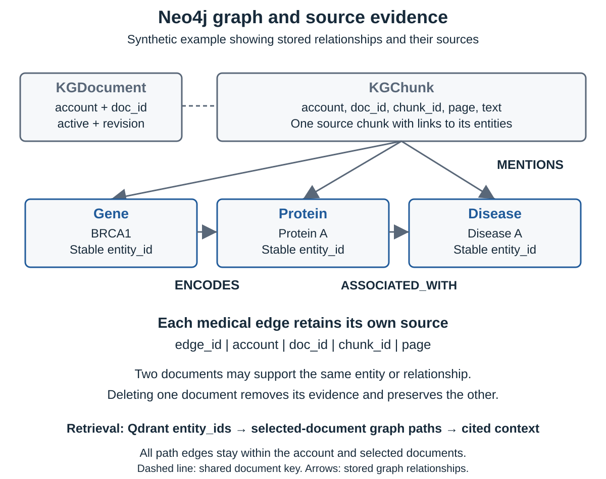

> Work plan dated 20 October 2026. Update on 25 October: authentication, document metadata/storage, and document read/download routes are now implemented; graph and ingestion integration remain in progress.

# GraphRAG Backend Structure and Work Plan

Neo4j and Qdrant responsibilities and integration

AGI 4 Knowledge Graph RAG Engine  |  20 October 2026

This plan divides backend work between the Neo4j owner and the Qdrant owner and defines how their components join into one authenticated document pipeline. It gives the pair a proposed ownership agreement, common data contracts and an order for integration while both work on feat/backend.

Figure 1  Target backend architecture with the two storage responsibilities. Shared service boxes describe work that still needs integration.

## Module ownership and task boundaries

Use one primary editor per file. The other owner reviews the connection points. These assignments are proposed for the two backend owners; confirm any overlap with other team members before changing shared services.

| Primary owner | Files or component | Work to complete |
| --- | --- | --- |
| You Neo4j | graph_schema.py repositories/graph_store.py routers/graph.py | Maintain entity and relationship rules, identities, sourced graph writes, search, expansion, traversal and graph API responses. |
| Teammate Qdrant | repositories/vector_store.py Embedding parts of models.py | Maintain collection setup, embedding dimensions, vector insertion, filtered search, deletion and Qdrant tests. |
| You Teammate reviews | schemas.py services/retrieval.py | Draft shared request and evidence types. Combine vector hits with bounded graph paths, deduplicate context and preserve citations. |
| Teammate You review | services/ingestion.py services/jobs.py | Coordinate PDF processing, graph revision tokens, embeddings and both stores. Handle retries, cancellation, replacement and cleanup. |
| Teammate You review | core/config.py | Load backend settings. Keep Neo4j, Qdrant, Supabase and Ollama settings in one agreed configuration interface. |
| You Teammate reviews | main.py | Create clients on startup, initialize storage, register completed routers and close clients on shutdown. |
| Team assignment required | core/auth.py document_store.py PDF parsing, extraction, generation and other routers | Assign owners for unfinished application services. The two database repositories do not complete these features by themselves. |

Each database owner owns the tests and setup notes for their repository. Avoid changing the other repository to solve an interface mismatch; agree the contract first, then let its owner make the change.

## Shared data and service contracts

These identifiers must describe the same source in Supabase, Neo4j and Qdrant. The API derives the account from a verified token and resolves selected ready documents before either repository is called.

| Field | Agreement |
| --- | --- |
| account | Authenticated account identifier. Never trust an account value supplied in a request body. |
| doc_id | Stable document ID assigned by the document service. Reuse it on retry; agree replacement semantics. |
| chunk_id and page | Use the same chunk ID and positive page number in both stores. Keep chunk boundaries stable within an indexing revision. |
| entity_ids | Use the list returned by Neo4j upsert_chunk directly in Qdrant ChunkVector. Do not independently generate graph IDs. |
| text | The chunk source text used for embeddings and source inspection. It is evidence, not an instruction to the application. |
| graph revision | Obtain once from begin_document and pass to all graph writes for the job. Save it with durable jobs if jobs survive restarts. |

## Repository handoff

Neo4j exposes begin_document, upsert_chunk, delete_document, search, node_details, traverse and expand. upsert_chunk returns the stable entity IDs to attach to the matching Qdrant record. Every graph read requires account and authorized document IDs.

Qdrant currently exposes create_collection, insert, search and delete. Its payload already carries doc_id, chunk_id, account, page, text and entity_ids. Its search and delete methods currently filter by document ID; the teammate should add account filtering or document and test the authorization guarantee at the caller.

## Lifecycle agreement

Only the coordinator changes a document to ready, after every required graph and vector write succeeds. A failure keeps the document unavailable for retrieval, cancels remaining work and cleans partial records. Neo4j revision checks protect graph writes; the Qdrant side also needs stale-job protection or a coordinator that prevents old writes after cancellation.

## Ingestion and replacement sequence

Figure 2  Proposed ingestion sequence. Ownership of the coordinator belongs to the primary editor of ingestion.py and jobs.py, with both database owners reviewing it.

Replacement first marks the document processing and prevents old work from continuing. A new graph revision clears previous graph evidence. The vector owner clears or replaces the corresponding vector records. A job cannot publish ready until both indexes represent the same document revision.

## Graph evidence and retrieval

Figure 3  Physical Neo4j model. Example names are synthetic. Source chunks and per-edge evidence preserve the document and page used for each graph fact.

Retrieval begins with an embedding of the question. Qdrant searches only authorized ready documents and returns chunk hits with entity_ids. The retrieval service passes those IDs to Neo4j with the same account and document scope, collects one- or two-hop paths, resolves source text, and merges the evidence for generation.

GraphRAG returns the paths and citations it actually used. Standard RAG uses the same document selection, embedding model and generation settings but takes context only from vector hits. Empty or insufficient evidence is reported explicitly.

## Working together on feat/backend

Working on one branch requires file coordination. Use small commits and reserve shared files before editing them. Do not rely on the branch name alone to prevent conflicts.

1  Before editing, fetch in GitHub Desktop and pull with a clean working tree. Check that feat/backend is selected and inspect the incoming commits.

2  Agree the files each person will edit during the work session. The primary editor handles the shared file; the other person reviews its contract or supplies a small patch.

3  Commit one coherent change at a time, such as graph storage, Qdrant filters or ingestion wiring. Include its relevant tests and documentation.

4  Before pushing, fetch again. If your teammate pushed first, integrate their changes, inspect any conflicts and rerun the affected tests. Do not force-push the shared branch.

5  Run the backend suite before integration. Review the graph-specific database check before merging into main. If file collisions become frequent, move to separate short-lived branches and pull requests.

## Integration order

| Stage | Done when |
| --- | --- |
| 1  Agree the contract | Both owners accept the identifier, scope, graph revision and readiness rules in this plan. |
| 2  Prove repositories | Neo4j real-database checks and Qdrant storage/filter checks pass independently. |
| 3  Index one PDF | The same chunk IDs and entity IDs can be inspected in both stores; status becomes ready only after both complete. |
| 4  Retrieve and cite | A query returns permitted vector evidence, a sourced graph path and the corresponding PDF page. |
| 5  Test lifecycle failures | Retry, partial failure, replacement, deletion, stale writes and another account cannot corrupt or expose results. |

## Current state and next actions

| Component | Verified state on 20 October 2026 |
| --- | --- |
| Neo4j schema and storage | Implemented locally: validated types, stable IDs, sourced writes, scoped graph reads, cleanup and revision fencing. |
| Qdrant storage | Existing collection, insert, search and delete functions are present. The existing seven tests passed unchanged. |
| Backend tests | 31 passed: 24 Neo4j unit tests and 7 existing Qdrant tests. Four live Neo4j tests were skipped. |
| Cloud Neo4j | The supplied hostname failed DNS resolution. Its credentials, constraints and graph queries were not verified against Aura. |
| Application integration | Authentication, ingestion, extraction, graph routes and hybrid retrieval remain outlines or incomplete integration points. |
| Remote test workflow | A Neo4j 5.26 integration workflow is included for pull requests. It has not been run remotely during this work. |

## Next work for you

Confirm that the Aura instance exists and is running, download its actual instance credentials, then run the connection checker and real-database tests. Review graph outputs with your teammate before wiring authenticated graph routes. Use the supplied Neo4j development sections to explain the storage implementation and its verified limits.

## Next work for your teammate

Confirm embedding dimensions and collection settings, align chunk IDs and graph entity_ids, enforce account/document filtering, and make retry and replacement safe for vector records. Then wire ingestion and cancellation using the agreed graph revision contract.

## Shared acceptance check

Use two documents that share an entity and a second account. Re-index without duplicates, retrieve a sourced two-hop path, delete one document while preserving the other evidence, block old jobs after replacement, and verify that the second account sees no private data. End-to-end completion requires these checks through authenticated application requests.

## References

Project requirements and design documents, repository snapshot c9df773 on feat/backend, and the Neo4j implementation added during this session. Driver and transaction guidance: neo4j.com/docs/python-manual/current/. Cypher and constraints: neo4j.com/docs/cypher-manual/current/.
